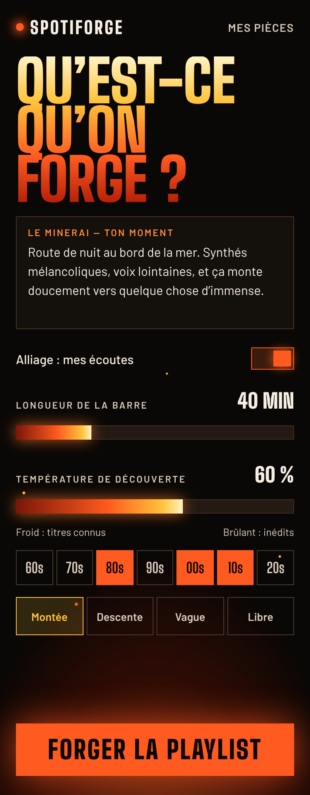
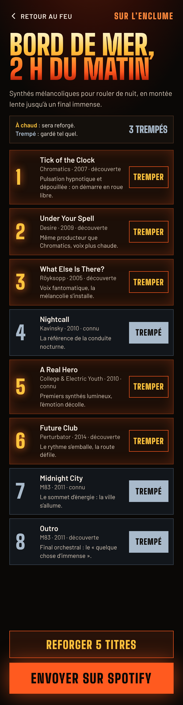

# Design

Direction artistique retenue : **Braise**. Règles et vocabulaire dans [`docs/DESIGN.md`](../docs/DESIGN.md).

## Contenu

| Chemin | Rôle |
|---|---|
| [`tokens.json`](tokens.json) | Couleurs, dégradés, lueurs, typographie, espacements. Source de vérité du thème de l'app |
| [`braise/creation.png`](braise/creation.png) | Écran Création, capture en 390 × 1000 (×2) |
| [`braise/apercu.png`](braise/apercu.png) | Écran Aperçu, capture en 390 × 1500 (×2) |
| [`braise/static/`](braise/static/) | Les deux écrans en HTML autonome, polices incluses. S'ouvrent dans un navigateur, sans réseau |
| [`braise/*.dc.html`](braise/) | Sources du canvas Claude Design. Elles ne s'affichent que dans le canvas |

## Aperçu

| Création | Aperçu |
|---|---|
|  |  |

## Comment s'en servir

- Pour coder un écran : pars de la capture, puis lis le HTML statique pour les valeurs exactes (tailles, espacements, couleurs). Les styles y sont en ligne, élément par élément.
- Les valeurs réutilisables sont dans `tokens.json`. Si une valeur du HTML n'y figure pas et sert à plus d'un endroit, ajoute-la aux tokens dans la même PR.
- Les captures figent l'état initial : trois titres trempés sur huit. Le comportement interactif est décrit dans `docs/DESIGN.md`.

## Écrans pas encore dessinés

Connexion Spotify, Mes pièces (historique et modèles), feuilles de réglage, états vides, chargement de la forge, erreurs. Ils sont à dessiner dans la direction Braise avant d'être codés : voir l'issue « Maquettes des écrans manquants ».

## Mettre à jour une maquette

Les maquettes sont éditées dans le canvas Claude Design, puis réexportées ici : source `.dc.html`, HTML statique et capture. Les trois doivent rester cohérents dans un même commit.

Les polices Big Shoulders Display et Barlow sont sous licence OFL 1.1 (textes dans `braise/static/fonts/`).
